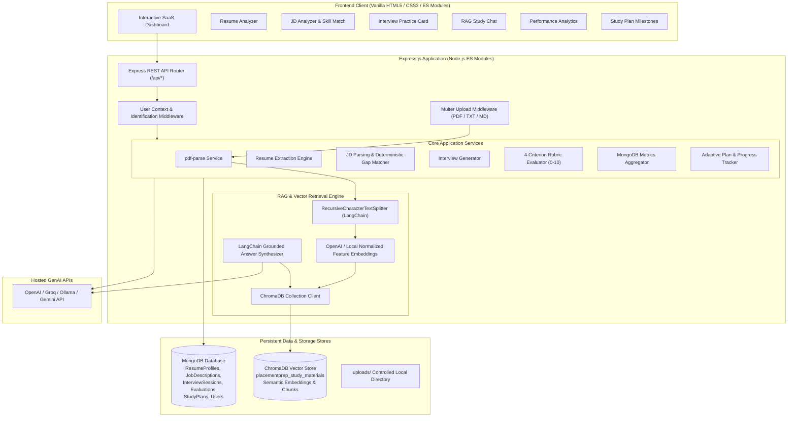

# PlacementPrep AI ⚡
> **Full-Stack GenAI Technical Interview Preparation Platform**  
> Powered by LangChain.js, ChromaDB, MongoDB, Express.js, and Vanilla Modern JavaScript.

[](https://nodejs.org/)
[](https://vitest.dev/)
[](LICENSE)

---

## 📌 Project Overview

**PlacementPrep AI** is an end-to-end GenAI web application built to empower college students and aspiring software engineers to prepare for technical interviews. The platform uniquely personalizes the preparation cycle by connecting:
1. **The Student's Resume** (PDF parsing and LLM structured background extraction).
2. **Target Job Descriptions** (algorithmic requirement extraction & deterministic skill-gap matching).
3. **Personal Study Materials & Cheat Sheets** (a production-grade Retrieval-Augmented Generation RAG pipeline with ChromaDB and LangChain.js).
4. **Interactive Mock Interviews & 4-Criterion Standardized Rubrics** (0–10 rubric scoring with attempt comparison).
5. **Real Database Performance Analytics & Adaptive Study Milestones**.

The student-facing interface is intentionally kept focused on three tasks: review a resume, practice interview questions, and ask questions about uploaded study notes. The additional analytics, job comparison, and study-plan APIs remain available for future expansion without crowding the main screen.

---

## 🏗️ Architecture Diagram



---

## 🛠️ Technology Stack

| Layer | Technologies Used | Description & Rationale |
| :--- | :--- | :--- |
| **Backend API** | Node.js (ES Modules), Express.js | High-throughput asynchronous REST server with structured error handling |
| **GenAI & RAG** | LangChain.js (`@langchain/core`, `@langchain/openai`, `langchain`) | Chains, prompts, `RecursiveCharacterTextSplitter`, and structured outputs |
| **Vector Store** | ChromaDB (`chromadb`) | Production vector database for storing chunks and semantic similarity queries |
| **Database** | MongoDB with Mongoose ODM | Primary transactional data store for profiles, sessions, evaluations, and plans |
| **Document Processing**| `pdf-parse`, `multer` | Robust PDF text extraction and strict multipart file validations |
| **Validation** | Zod | Runtime TypeScript-grade schema validation for API inputs and model outputs |
| **Frontend** | Vanilla HTML5, CSS3, ES JavaScript | High-performance, framework-free SaaS UI served directly via Express static middleware |
| **Testing** | Vitest, Supertest | Fast unit and integration test runner for ES Modules |

---

## 🚀 Key Features

### 1. 📊 SaaS Student Dashboard
- Instant visual diagnostics on total interview attempts, average rubric score, indexed study documents count, and study plan milestone progression.
- Real-time service status pills for MongoDB, ChromaDB, and LangChain model connectivity.

### 2. 📄 Resume Analyzer
- Supports direct PDF upload (drag-and-drop or file picker) with size limits (10MB).
- Extracts text via `pdf-parse` and processes structured profiles through LangChain + Zod.
- Categorizes technical skills: Languages, Frameworks, Databases, Tools, Cloud/DevOps, and Core CS Concepts.
- Displays personal information, verified education records, key projects, and internships.

### 3. 💼 Job Description Analyzer & Skill Gap Match
- Paste job description text or target roles.
- Extracts required skills, preferred qualifications, responsibilities, and technical topics.
- Deterministic JavaScript matching logic:
  - **Matching Skills** (green badges).
  - **Skills Not Mentioned in Resume** (amber badges; neutral phrasing).
  - **Relevant Projects**: Maps candidate projects that demonstrate required technologies.
  - **Match Percentage Meter**: Calculates coverage against required skills.
  - **One-click "Practice for this Role"** action button.

### 4. 🎯 Personalized Interview Practice & 4-Criterion Rubric
- Generates targeted interview questions based on candidate projects, JD expectations, and calibrated difficulty (Beginner, Intermediate, Advanced, Mixed).
- Question types include Conceptual, Scenario-based, Coding/Algorithmic, and Project Deep-Dives.
- Expandable progressive hints.
- **Standardized 4-Criterion Evaluation Rubric (Total: 0 to 10 points)**:
  - **Technical Correctness (0–4)**
  - **Coverage of Key Concepts (0–3)**
  - **Clarity & Communication (0–2)**
  - **Relevant Example / Scenario Application (0–1)**
- Identifies addressed concepts vs missing concepts.
- Actionable suggestions and top-tier model improved answers.
- **Retry Feature**: Allows students to re-attempt questions and tracks score improvements across attempts.

### 5. 📚 RAG Study Assistant with Strict Grounding
- Upload lecture notes, PDF interview guides, and Markdown documentation.
- Chunking using LangChain `RecursiveCharacterTextSplitter` (chunk size: 800, overlap: 150).
- Chunks and metadata (`documentId`, `filename`, `ownerId`, `chunkIndex`, `pageNumber`) are embedded and indexed into ChromaDB.
- **Strict Grounding Rules**:
  - Answers strictly derived from retrieved evidence.
  - Inline source citations: `[Source: filename, Page: X]`.
  - Acknowledges when evidence is insufficient: *"Based on the provided study materials, there is not enough information to answer this question."*
  - Document deletion automatically cleans up both MongoDB metadata and ChromaDB vector embeddings.

### 6. 📈 Performance Analytics
- Aggregated from actual MongoDB records:
  - Total questions attempted.
  - Overall average score across all sessions.
  - Rubric component breakdown averages.
  - Topic performance rankings (Strong vs Needs Work).
  - Chronological score progression timeline.
  - AI-prioritized revision topics.

### 7. 📅 Adaptive Study Plan Generator
- Generates 7-day, 14-day, or 30-day study curriculums tailored to skill gaps and weak topics.
- Modular daily goals with estimated hours, priority indicators, learning activities, and practice questions.
- Interactive checklist with real-time toggle progress updating (`PATCH /api/study-plans/:id/progress`).

---

## ⚙️ Installation & Setup (Without Docker)

### Prerequisites
- **Node.js**: v20+ (`node -v`)
- **npm**: v9+ (`npm -v`)
- **MongoDB**: Running locally on `mongodb://127.0.0.1:27017` or a free MongoDB Atlas connection string.
- **ChromaDB** (Optional for live vector store): Chroma server running on `http://localhost:8000`.

### Step 1: Install Dependencies
```bash
npm install
```

### Step 2: Configure Environment Variables
Copy the example environment file:
```bash
cp .env.example .env
```
Edit `.env` to configure your credentials:
```env
PORT=3000
MONGODB_URI=mongodb://127.0.0.1:27017/placementprep
CHROMA_URL=http://localhost:8000
CHROMA_COLLECTION_NAME=placementprep_study_materials

# LLM API Key (OpenAI, Groq, Ollama, OpenRouter, or Gemini OpenAI-compatible endpoint)
# Leave blank to run in offline development / mock fallback mode!
LLM_API_KEY=
LLM_MODEL=gpt-4o-mini
```

### Step 3: Start MongoDB
If using Homebrew on macOS:
```bash
brew services start mongodb-community
# or run directly:
mongod --config /opt/homebrew/etc/mongod.conf
```

### Step 4: Start ChromaDB (Optional)
If you have Python installed, launch Chroma:
```bash
pip install chromadb
chroma run --path ./chroma_data --port 8000
```
> *Note: If ChromaDB or MongoDB are offline during initial development, PlacementPrep AI logs a friendly notice and operates gracefully in offline fallback mode.*

### Step 5: Start PlacementPrep AI
```bash
# Start in production mode:
npm start

# Or start with live file watching (dev mode):
npm run dev
```

Open your browser to:
👉 **`http://localhost:3000`**

---

## 🧪 Testing

The test suite contains 28 automated tests covering schemas, chunking, rubric evaluation, skill matching, RAG retrieval grounding, and REST endpoints:

```bash
npm test
```

### Test Coverage Highlights:
- **`validators.test.js`**: Validates Zod schemas for profiles, JDs, questions, rubric scores, and study plans.
- **`skillMatching.test.js`**: Verifies deterministic technology synonym normalization and gap calculation.
- **`rubricEvaluation.test.js`**: Tests 4-criterion rubric scoring (0-10) and concept detection.
- **`chunking.test.js`**: Tests LangChain `RecursiveCharacterTextSplitter` and chunk metadata enrichment.
- **`retrievalGrounding.test.js`**: Evaluates RAG retrieval precision and insufficient evidence handling on a dedicated technical evaluation dataset.
- **`api.test.js`**: Supertest integration testing for Express endpoints, user isolation (`x-user-id`), and validation error handling.

---

## 📡 REST API Reference

| Method | Endpoint | Description |
| :--- | :--- | :--- |
| `GET` | `/api/health` | System health check (MongoDB, ChromaDB, LLM status) |
| `POST` | `/api/resumes/upload` | Upload PDF resume, extract text, and parse structured profile |
| `GET` | `/api/resumes` | Retrieve all uploaded resume profiles for current user |
| `GET` | `/api/resumes/:id` | Get specific resume profile |
| `POST` | `/api/jobs/analyze` | Parse job description text and compare against resume |
| `GET` | `/api/jobs` | List analyzed job descriptions |
| `POST` | `/api/jobs/compare` | Explicitly compare specific job with specific resume |
| `POST` | `/api/interviews/generate` | Generate personalized interview questions session |
| `GET` | `/api/interviews` | List interview sessions |
| `GET` | `/api/interviews/:id` | Retrieve interview session details and questions |
| `POST` | `/api/interviews/:id/answer` | Submit answer for rubric evaluation (0–10 score) |
| `GET` | `/api/interviews/history` | Get all historical evaluated attempts |
| `POST` | `/api/documents/upload` | Upload study document (PDF/TXT/MD) and index to ChromaDB |
| `GET` | `/api/documents` | List indexed study materials |
| `DELETE`| `/api/documents/:id` | Delete document from MongoDB and purge vector chunks from ChromaDB |
| `POST` | `/api/chat` | Ask RAG study assistant with strictly grounded source citations |
| `GET` | `/api/analytics` | Retrieve real aggregated metrics, rubric breakdown, and topic trends |
| `POST` | `/api/study-plans/generate` | Generate personalized study milestones |
| `GET` | `/api/study-plans` | List active study plans |
| `PATCH`| `/api/study-plans/:id/progress` | Toggle milestone completion checkbox and update progress % |

---

## 🔒 Security & Privacy Practices

- **Isolated File Storage**: Resumes and study materials are stored in a private `uploads/` directory; they are never exposed through public static middleware.
- **Strict User Segregation**: Documents and vectors in ChromaDB are filtered with `where: { ownerId }` ensuring multi-user isolation.
- **Vector Cleanup**: Deleting a study document purges its vector embeddings from ChromaDB immediately to prevent orphaned context leakage.
- **No Hardcoded Keys**: API keys and secrets are loaded strictly from environment variables via `dotenv`.

---

## 📷 Screenshots

| Dashboard Overview | Resume & JD Match |
| :---: | :---: |
|  |  |

| Interview Rubric Evaluation | RAG Study Assistant with Citations |
| :---: | :---: |
|  |  |

---

## 📄 License
MIT License. Built for students, university cohorts, and software engineering candidates.
